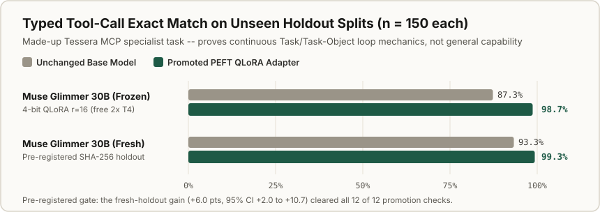
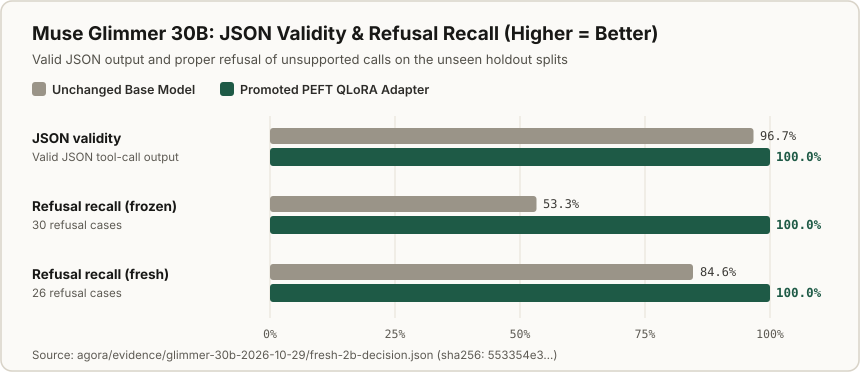
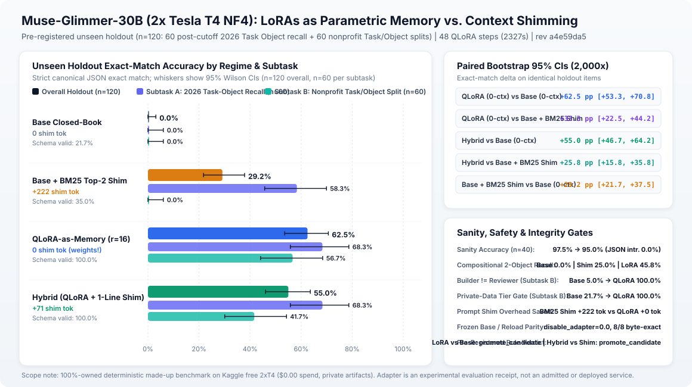
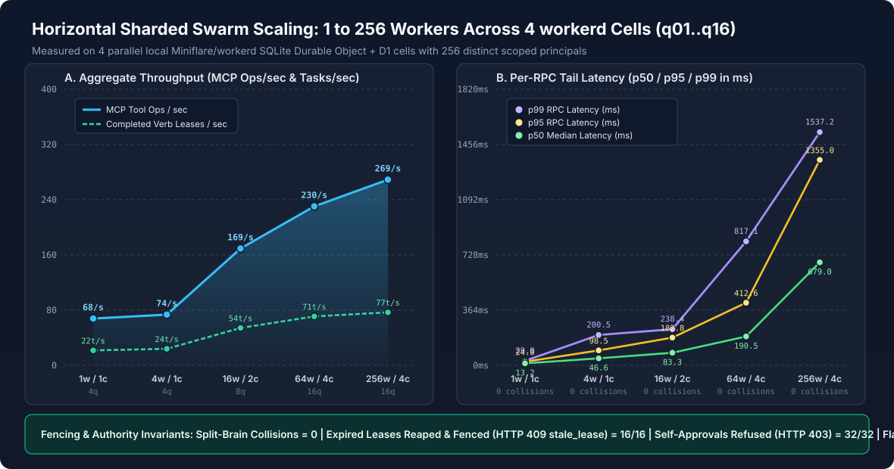
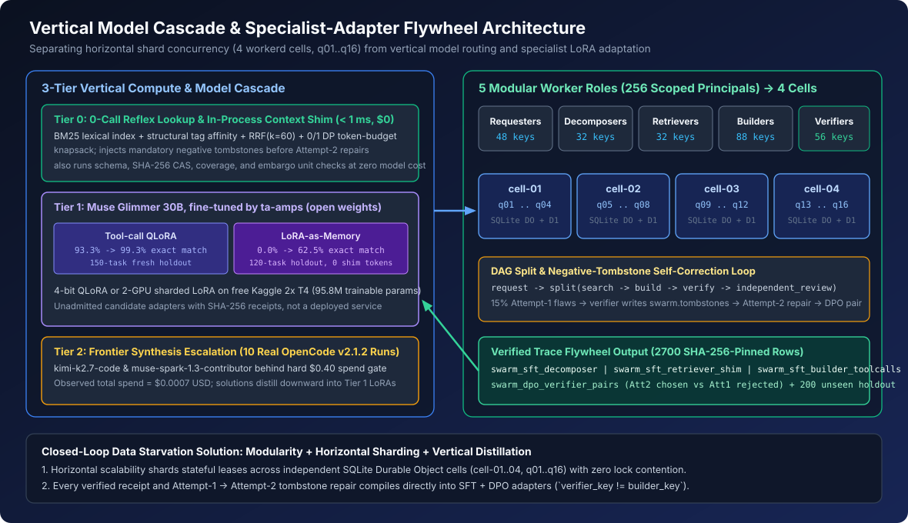
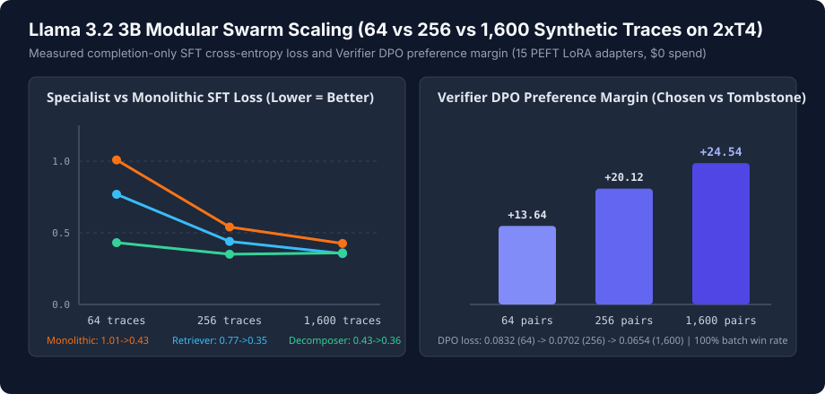
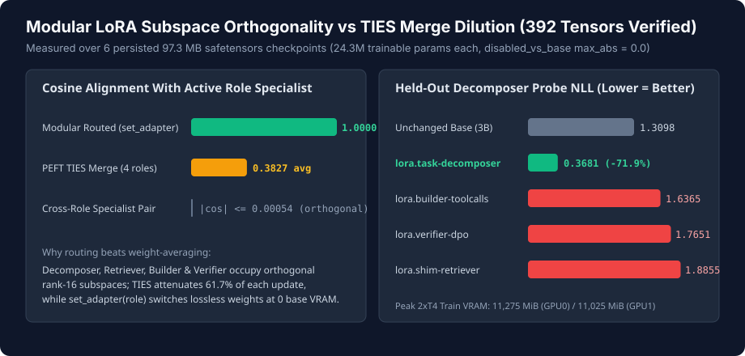

# Pre-Registered Evaluation, LoRA-as-Memory & Scalability Benchmarks

Every model-tuning round in `ta-amps` is scored by a deterministic evaluation Task (`verb.benchmark_harness`) and gated by a pre-registered promotion rule Task Object (`tool-call-specialist.promotion` v1, `sha256: bf0fa821717c2400faab77652f067ea85f2616eea329c6e139af33a423e4b3b7`) fixed before training runs.

> **What these benchmarks show -- and what they do not:** All splits evaluate bounded, synthetic Tasks (producing schema-valid Tessera MCP JSON tool calls, recalling post-cutoff 2026 Task Objects without context bloat, or decomposing nonprofit intake briefs with `builder != reviewer` and contributor-tier privacy checks). They prove that the continuous Task and Task-Object learning loop measures real specialist gains, blocks contaminated rows, and rejects regressions; they are not general LLM capability claims.

## 1. Typed MCP Tool-Call Specialist Accuracy (`n = 150`)

| Base Model | Tuning Method | Split (`n = 150`) | Base | Tuned | Paired Delta & Gate Outcome |
| --- | --- | --- | --- | --- | --- |
| **Muse Glimmer 30B** | 4-bit `bitsandbytes` QLoRA (`2x T4`) | Pre-registered fresh holdout | `93.3%` | **`99.3%`** | `+6.0%` (`95% CI [+2.0%, +10.7%]`), **12/12 checks passed** |
| **Muse Glimmer 30B** | 4-bit `bitsandbytes` QLoRA (`2x T4`) | Frozen unseen-family test | `87.3%` | **`98.7%`** | `+11.3%` (`95% CI [+5.3%, +18.0%]`), 8/8 reload match |
| **Llama 3.2 3B Instruct** | `bf16` `peft` LoRA (`1x RTX 3060`) | Frozen unseen-family test | `52.0%` | **`72.7%`** | `+20.7%` (`95% CI [+12.0%, +29.3%]`), Round 1 promoted |
| **Llama 3.2 3B Instruct** | `bf16` `peft` LoRA (`1x RTX 3060`) | Round 2 candidate (rejected) | `72.7%` (champ) | `79.3%` | **Rejected by gate:** schema validity fell `0.025` (limit `0.020`) |
| **Llama 3.2 1B Instruct** | `bf16` `peft` LoRA (`1x RTX 3060`) | Frozen unseen-family test | `12.0%` | **`50.7%`** | `+38.7%` cumulative by Round 3; Round 4 rejected on schema drop |

---

## 2. Muse Glimmer 30B LoRA-as-Memory Benchmark (`n = 120`, Pre-Registered SHA-256 Holdout)

Can a PEFT LoRA adapter (`r=16, alpha=32`, trained in `48` steps on free Kaggle `2x Tesla T4` GPUs) internalize post-cutoff 2026 Agent Harness & Fabric **Task Objects** (`Subtask A`, `n=60`) and plain-English nonprofit intake decomposition (`Subtask B`, `n=60`) directly into weights -- eliminating repetitive `[NOUN/VERB CONTEXT]` shim tokens at inference time?

| Evaluation Regime (`test_holdout.jsonl`, `sha256: a5f59267...`) | Avg Shim Tokens | Overall Exact Match | Subtask A Recall (`n=60`) | Subtask B NGO Split (`n=60`) | JSON / Schema Valid | Median Latency (`p50`) |
| --- | --- | --- | --- | --- | --- | --- |
| **Base Closed-Book** | `0.0` | `0.0%` | `0.0%` (`0.0%` F1) | `0.0%` (`0.0%` F1) | `59.2%` / `21.7%` | `18.07s` |
| **Base + BM25 Top-2 Context Shim** | `222.3` | `29.2%` | `58.3%` (`70.8%` F1; `25.0%` 2-obj) | `0.0%` (`0.0%` F1) | `80.0%` / `60.0%` | `19.75s` |
| **LoRA-as-Memory (Weights Only)** | **`0.0`** | **`62.5%`** | **`68.3%`** (`86.9%` F1; **`45.8%`** 2-obj) | **`56.7%`** (**`98.1%`** F1) | **`100.0%` / `100.0%`** | **`8.67s` (`2.28x` faster)** |
| **Hybrid (`LoRA + 71-tok Pointer`)** | `71.1` | `55.0%` | `60.0%` (**`94.4%`** F1; **`50.0%`** 2-obj) | `50.0%` (`97.9%` F1) | **`100.0%` / `100.0%`** | `10.17s` |

- **Paired bootstrap significance:** LoRA-as-Memory (`0` shim tokens) beat Base + BM25 Top-2 Shim (`222.3` shim tokens) by **`+33.3` percentage points** (`95% CI [+22.5, +44.2]` pp) and Base Closed-Book by **`+62.5` percentage points** (`95% CI [+53.3, +70.8]` pp).
- **Governance & reload parity:** `100.0%` `builder_principal != reviewer_principal` separation, `100.0%` contributor-tier refusal on private-data scenarios, `95.0%` plain-text sanity retention (`0.0%` JSON intrusion), and `8/8` byte-exact fresh-base reload regeneration (`max_abs = 0.0`).

---

## 3. Horizontal 256-Worker Swarm & Vertical Compute Cascade

- **Measured 256-Worker OpenCode / MCP Swarm (`SCALABILITY_BENCHMARK.json`):** `256` distinct scoped worker principals across `4` `workerd` cells (`q01..q16` queues) executed `1,000` synthetic workflows (`5,000` leased Tasks, `25,620` MCP JSON-RPC calls at `54.4 ms` p50 latency, `0` lease collisions, `0` self-approvals, `100%` contributor-tier refusal on private fixtures), emitting `2,500` verified synthetic training rows and `200` disjoint holdout rows (`0` overlap).

### Measured 15-Adapter Data-Scaling & Subspace Orthogonality (`Llama-3.2-3B-Instruct`, Free Kaggle `2x T4`)

- **15 PEFT SFT/DPO Adapters + 2 Linear/TIES Merges (`glimmer-modular-swarm-2026-10-31`):** Across `64 -> 256 -> 1,600` synthetic OpenCode-Swarm traces on free Kaggle `2x Tesla T4` GPUs (`11.27 GiB` / `11.03 GiB` peak VRAM, `$0` spend), `lora.shim-retriever` SFT loss dropped **`0.769 -> 0.440 -> 0.355`**, `lora.task-decomposer` cut held-out decomposition cross-entropy **`1.310 -> 0.368` (`-71.9%`)**, and `lora.verifier-dpo` (`SFT + DPO` on chosen vs `noun.negative_tombstone` pairs) expanded preference margin **`+13.64 -> +20.12 -> +24.54`** (`100.0%` batch win rate).
- **Why Dynamic `set_adapter(role)` Beats Static Weight Merging:** Direct inspection of the six `97.3 MB` `.safetensors` checkpoints (`392` `F32` tensors, `24,313,856` trainable parameters each) shows pairwise cosine similarity **`|cos| <= 0.00054`** across the four specialist roles (near-exact mathematical orthogonality), whereas static `add_weighted_adapter(..., combination_type="ties")` attenuates alignment with each specialist to **`0.377..0.388`** (`~61.7%` loss of directional alignment). *(Honesty note: Stage 4 batched greedy generation at `batch_size=13..25, max_new_tokens=1,472` hit T4 VRAM OOM after saving all 17 manifests and 6 `.safetensors` checkpoints, so no batched greedy holdout exact-match score is claimed from that scaling run.)*

---

## Three Anti-Cheating Guarantees

1. **Disjoint Tool Families & Three-Fingerprint De-duplication:** Tool-call training prompts only expose `lease`, `verb discovery`, `records`, and `access` tools while holdouts test unseen `buckets` and `feeds` families. Curation hashes exact text, normalized request, and slot-masked template shape so zero evaluation shapes leak into training.
2. **Pre-Registered SHA-256 Holdouts:** Both the 150-row Glimmer tool-call holdout (`0ce30e9f...`) and the 120-row Glimmer LoRA-as-Memory holdout (`a5f59267...`) were SHA-256-pinned before any GPU scored them.
3. **Negative Results Caught by the Gate:** On both Llama 3.2 1B (Round 2 and Round 4) and Llama 3.2 3B (Round 2, despite `79.3%` exact match), candidates that hurt schema validity or failed paired bootstrap bounds were automatically kept out by `decide_promotion`.

## Raw Receipts & Reproducible Verifiers

- **Muse Glimmer 30B Evidence Bundle:** [`agora/evidence/glimmer-30b-2026-10-29/`](https://github.com/ta-amps/agora-public-overview-architecture-setup-and-contribution/tree/main/evidence/glimmer-30b-2026-10-29)
- **Llama 3.2 1B & 3B Evidence JSONs:** [`tessera/examples/continuous_tuning/evidence/`](https://github.com/ta-amps/tessera-infrastructure-work-and-storage-engine/tree/main/examples/continuous_tuning/evidence)
- **Adapter Configs, Step-by-Step Kaggle/Llama Guides & Provenance Digests:** [`../training/README.md`](../training/README.md)
