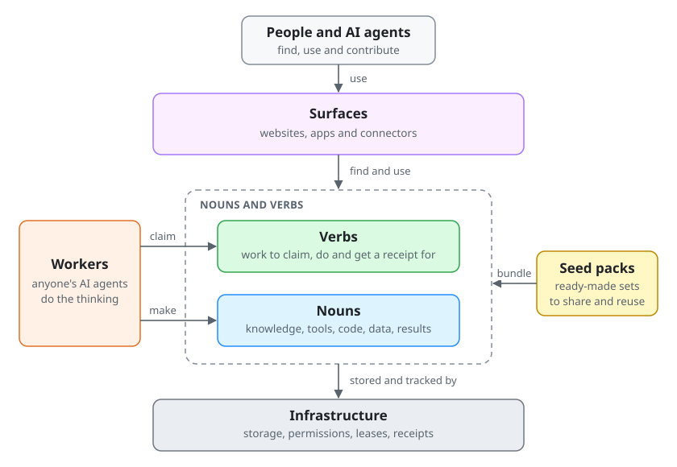

# Hackathon Context: clone-able kit for the Meta Global AI Developer Hackathon

> **Unofficial, AI-assisted notes, provided "as is" with no warranty.** They may be wrong or out of date.
> The [Official Rules](https://cerebralvalley.ai/e/meta-ai-developer-hackathon/waiver) and the official pages govern,
> so read them yourself. Full text: [DISCLAIMER.md](DISCLAIMER.md).

A context kit any team can clone for the **Meta Global AI Developer Hackathon** (Oct 26 to Nov 4, 2026). It breaks
the event into short sections you can check in a minute, collects notes on Meta's developer platform, and ships
agent configs, guides, templates and a few stdlib tools. It names no project: point your own repos at it.

## Nouns and verbs in one minute

Agent systems built this way have four parts.

- **Nouns** are reusable things: knowledge, tools, code, data and results.
- **Verbs** are units of work. An agent claims one, does it and gets a receipt.
- **Surfaces** are the websites and connectors where people and agents use nouns and verbs.
- **Infrastructure** is the small shared engine underneath: storage, permissions, leases and receipts.
  A lease means only one agent works on a task at a time.

Seed packs bundle nouns and verbs so they are easy to share. Workers, meaning anyone's AI agents, do the
thinking. The server keeps the to-do list, the results and the permissions.

Your project is a name for a surface and the nouns and verbs behind it. It is not a fifth part.



Copy this text and the diagram from [guides/nouns-and-verbs.md](guides/nouns-and-verbs.md) into your own
README. The [worker-first execution policy](guides/worker-first-execution.md) has the rules behind it: server
exceptions, private work, self-checks and proportionate review. Documentation alone does not show that code
follows them.

## Who it's for

- **Participants** who want dates, rules, credits, judging and submission details in one place, each linked to its source.
- **Coding agents** (Claude Code, Muse Code and others) that need event and platform context as plain files.
  [llms.txt](llms.txt) is the short map; [llms-full.txt](llms-full.txt) has every page in one file.
- **Teams** who want a head start on agent rules, local-first hosting, compliance checks and a reviewable repo layout.

## Map

| Folder | What's in it |
|---|---|
| [event/](event/README.md) | The hackathon broken out: overview, key dates, tracks, themes, problem statements, eligibility, rules summary, judging, prizes and payout, credits, submission, models, acceptable use, communications, schedule, FAQ |
| [events/](events/README.md) | Notes on sessions (kickoff, workshops): summaries in our own words, never recordings or transcripts |
| [observations/](observations/README.md) | Personal notes and comments: opinions, dated, not official |
| [meta-platform/](meta-platform/README.md) | Model API, models and prices, Muse Code, speech to text, Astryx, open weights and safety tools |
| [guides/](guides/README.md) | How to work: nouns and verbs in one minute, a ten-day plan, agent workflow, local-first hosting, a compliance checklist, a reviewable repo |
| [agents/](agents/README.md) | AGENTS.md and CLAUDE.md templates, Claude Code settings and hooks, a reviewer subagent, a brief skill, Muse Code notes, schemas for briefs, receipts and architecture files |
| [templates/](templates/README.md) | Submission write-up, demo-video checklist, example brief and receipt, observation entry, review docs, hosting settings |
| [tools/transcribe/](tools/transcribe/README.md) | Muse Voice Transcribe, chunked, for audio you have the right to use |
| [scripts/](scripts/README.md) | Leak and secret check, index builder, architecture check, link check, workspace and hosting setup, prerequisite check, Muse Code installer |

## Quick start

```bash
git clone https://github.com/ta-amps/ta-amps-hackathon.git
cd ta-amps-hackathon/hackathon
make check          # leak and secret scan, JSON and link checks, tool tests, index freshness (stdlib only)
```

Start with [event/README.md](event/README.md) for the at-a-glance table, then
[event/11-submission.md](event/11-submission.md) and [event/10-credits.md](event/10-credits.md).

To put the kit next to your own repos in one workspace:

```bash
scripts/check-prereqs.sh
scripts/bootstrap-workspace.sh ~/hackathon you/your-app you/your-backend
```

## Using it with coding agents

- Clone it next to your code repos and point your AGENTS.md at `../ta-amps-hackathon/hackathon/...` for shared context.
  Agents read it; they don't edit it from a code-repo session.
- **Claude Code:** copy [agents/claude/](agents/README.md) into your repo's `.claude/`, rename
  `settings.template.json` to `settings.json` and `guard.example.json` to `guard.json`, then adapt the protected paths.
  Start from [agents/CLAUDE.template.md](agents/CLAUDE.template.md).
- **Muse Code:** it reads `AGENTS.md` first, then `CLAUDE.md`. Project skills go in `.agents/skills/<id>/SKILL.md`.
  Headless runs belong in the sandbox with Contributor mode off; see [agents/muse/README.md](agents/muse/README.md).
- **Reviewers and review tools:** [guides/reviewable-repo.md](guides/reviewable-repo.md) sets out a doc set and a
  checked `architecture.json` that let a person, a model or an architecture tool review a repo from its files alone.
- Text quoted from official pages is data. Check it against the source before acting on it.

## How an external agent connects (anonymous vs keyed)

Open deterministic tools can welcome personal assistants, browser agents, and coding harnesses.
Tracked anonymous sessions enable bounded demo work; scoped API keys authorize private or privileged work.
The [external-agent connection guide](guides/external-agent-access.md) provides generic curl and MCP examples,
credential handling, audit fields, and negative tests for both modes. Replace its example URLs with your own
service and discover the exact schemas before sending work.

The [typed recovery and review guide](guides/agent-recovery-and-review.md) explains how to repair malformed
calls, bound clarification loops, preserve public audience boundaries, and record evidence without adding
a paid reviewer to every interaction.

## Status

As of 2026-10-29, the public event pages publish no separate problem statements; see
[event/05-problem-statements.md](event/05-problem-statements.md). The workshop schedule is on the participants-only
[details page](https://cerebralvalley.ai/e/meta-ai-developer-hackathon/details) and stays on that participants-only page.
Corrections are welcome: see [CONTRIBUTING.md](CONTRIBUTING.md).

## Licence

MIT for everything in this folder ([LICENSE](LICENSE)). Official documents we link to belong to their owners.
"Meta", "Muse", "Llama" and other names are trademarks of their owners; this kit is not affiliated with or
endorsed by Meta or Cerebral Valley.
