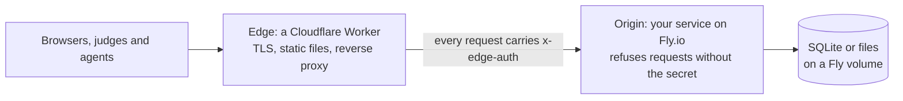

# Hosting: local first, then a permanent address

Get a service working end to end on your own machine, with the same edge code you will run in production,
before you create any accounts. Then move it to free hosted names with one script. As of 2026-10-26; check
the providers' pages for current limits and prices.

## The shape

- **One edge, one origin.** The Worker serves the public address and forwards to the origin. The origin also
  answers on its own `fly.dev` name, so the edge proves itself with a shared secret: the Worker adds an
  `x-edge-auth` header and the origin answers 403 to anything without the matching value, except its health
  check.
- **Free names first, or one domain split into subdomains.** `<worker>.<your-subdomain>.workers.dev` and
  `<app>.fly.dev` cost nothing and need no domain. If your entry spans more than one surface (for example a
  detection app, a public-good tools catalog, and a shared queue backend), buy **one** domain on Cloudflare
  Registrar and give each Worker its own subdomain (`app.example.org`, `tools.example.org`, `fabric.example.org`)
  via [Workers custom domains](https://developers.cloudflare.com/workers/configuration/routing/custom-domains/):
  Cloudflare creates the DNS record and TLS certificate automatically on deploy at no extra cost.
- **Writes are never cached** at the edge, and streaming responses pass straight through.

## Step 1: local, no accounts

1. Run your service on a local port, for example `127.0.0.1:7701`.
2. Run the real Worker code in front of it with
   [`npx wrangler@4.149.0 dev`](https://developers.cloudflare.com/workers/wrangler/commands/), pointing its
   origin variable at your local port and putting a throwaway edge secret in `.dev.vars` (gitignore it).
3. Need a public address so web-based agents or teammates can reach it? A
   [quick tunnel](https://developers.cloudflare.com/cloudflare-one/connections/connect-networks/do-more-with-tunnels/trycloudflare/)
   (`cloudflared tunnel --url http://127.0.0.1:7700`) gives a temporary `*.trycloudflare.com` address with no
   account. It is for testing only, has no uptime promise and changes every run.
4. Prove the lock: a request straight to the origin without the header gets 403; through the edge it works.

Pick ports nothing else uses (`ss -ltn` lists the busy ones) and make them overridable.

## Step 2: hosted

1. Create the accounts (Cloudflare, Fly.io) under the identity you want in public links, and choose a neutral
   `workers.dev` subdomain: it appears in every link.
2. Log in on your machine: `fly auth login` and `npx wrangler@4.149.0 login`.
3. Copy [scripts/bootstrap-hosting.sh](../scripts/bootstrap-hosting.sh) into your repo's `deploy/` folder and
   [templates/hosting.env.example](../templates/hosting.env.example) next to it as `hosting.env`. Fill in the
   app name, volume, secret name and Worker config path. Then run `deploy/bootstrap-hosting.sh --dry-run`,
   then the same command without `--dry-run`. It creates the Fly app and volume, sets one fresh edge secret
   on both sides through stdin, asks for any extra secrets with input hidden, and never prints a secret.
4. Deploy from GitHub Actions, not from your laptop. Create a `production`
   [environment](https://docs.github.com/en/actions/managing-workflow-runs-and-deployments/managing-deployments/managing-environments-for-deployment)
   with yourself as required reviewer and put the deploy tokens there, so a job sees them only after you
   approve it. Start the workflow by hand; nothing deploys on push.

## Secrets

| Secret | Lives in | Never |
|---|---|---|
| Model API key | the origin's secret store (Fly secrets) | in the repo, a chat, a log, a command line or the browser |
| Edge secret | Fly secrets and the Worker's secrets, same value | printed; rotate by rerunning the script with `--secrets-only` |
| Deploy tokens | the GitHub `production` environment | on a developer machine after setup |

## Before judging

- Keep one machine running (`min_machines_running = 1` in
  [fly.toml](https://fly.io/docs/reference/configuration/)) so the demo never waits on a cold start.
- Freeze deploys a day or two before the deadline, and record the demo from a build you can run offline.
- If your service calls Meta's Model API, don't offer the hosted version to end users in restricted
  territories ([compliance-checklist.md](compliance-checklist.md)).
