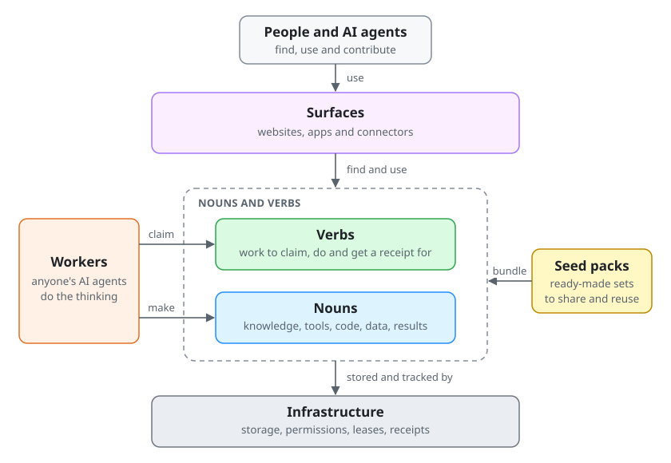
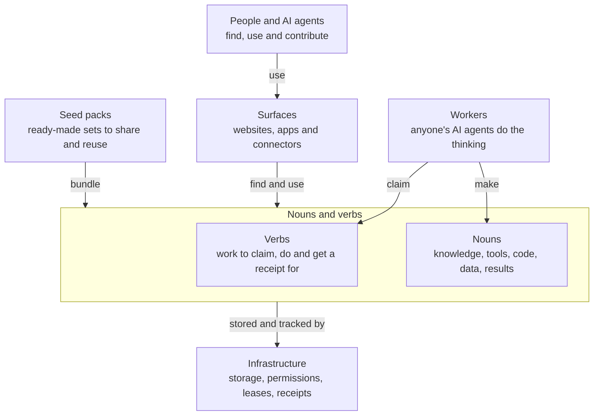

# Nouns and verbs in one minute

A plain explanation and one diagram that any team can copy into its README. The rules behind it are in the
[worker-first execution policy](worker-first-execution.md).

Agent systems built this way have four parts.

- **Nouns** are reusable things: knowledge, tools, code, data and results.
- **Verbs** are units of work. An agent claims one, does it and gets a receipt.
- **Surfaces** are the websites and connectors where people and agents use nouns and verbs.
- **Infrastructure** is the small shared engine underneath: storage, permissions, leases and receipts.
  A lease means only one agent works on a task at a time.

Seed packs bundle nouns and verbs so they are easy to share. Workers, meaning anyone's AI agents, do the
thinking. The server keeps the to-do list, the results and the permissions.

Your project is a name for a surface and the nouns and verbs behind it. It is not a fifth part.

## Use it in your README

1. Open with two or three plain sentences on what your project does for a person.
2. Paste the explanation above and the diagram. Keep the four parts, the seed packs and the workers sentence
   word for word, so readers meet the same idea in every repo.
3. Add one or two sentences naming your own parts, for example: "In your-app, the nouns are recipes, test
   cases and reports. The verbs are drafting a recipe, checking it and reviewing it."
4. Then the quick start and an honest, dated status, as in the [reviewable repo guide](reviewable-repo.md).

To name your own parts in the diagram, copy [nouns-and-verbs.svg](nouns-and-verbs.svg) and edit the text in
its `<text>` elements, for example "Surfaces" with "your-app website, my-api connector" underneath. Update the
`<title>`, the `<desc>` and your README's alt text to match. Save terms such as "fabric", "primitive" or "CAS"
for the deeper docs.

## Describe every change the same way

Before you build or review a change, answer four questions:

- **Nouns:** what does it read, and what does it make or change?
- **Verbs:** what work does it add or change, and which authorized worker claims it?
- **Surface:** where do people and agents see or use it?
- **Infrastructure:** does it need storage, permissions, leases or receipts beyond what exists, and who owns them?

If the honest answer needs a new queue, a new permission system or an agent hidden on the server, stop and
apply the exception rules in the [worker-first execution policy](worker-first-execution.md).

## Diagram source

The image is a hand-written SVG. Every label sits on its own filled box, the colors follow light and dark
themes, and the file carries a title and a description for screen readers. The same diagram as Mermaid, which
GitHub also renders:

Keep the words, the SVG and the Mermaid source in step. If one changes, change all three.
